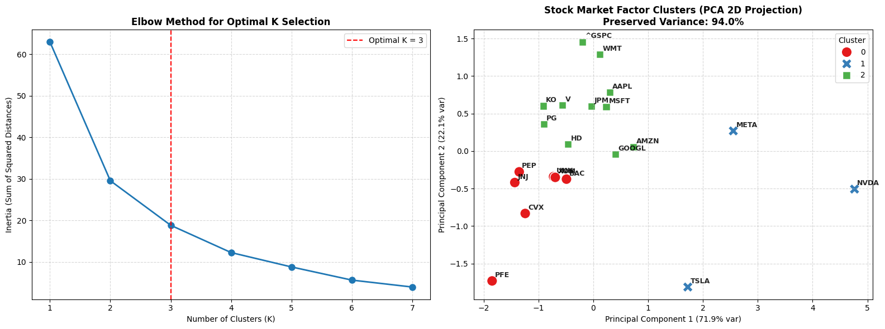

# 📈 Factor Investing & Stock Clustering using Unsupervised Machine Learning

This repository implements an end-to-end quantitative pipeline to group S&P 500 stocks based on their behavioral and financial risk profile rather than traditional market sectors, using **K-Means Clustering** and **Principal Component Analysis (PCA)**.

---

## 🎯 Executive Summary
Traditional portfolio management relies heavily on GICS sectors (Tech, Healthcare, Financials). In **Quantitative Factor Investing**, assets are categorized by mathematical characteristics:
1. **Annualized Volatility (Risk Factor):** Standard deviation of continuous log returns scaled by $\sqrt{252}$.
2. **Momentum (Trend Factor):** Total cumulative return over the analyzed period.
3. **Sharpe Ratio (Efficiency Factor):** Risk-adjusted return performance.

---

## 🛠️ Technical Pipeline & Methodology

1. **Data Ingestion & Feature Engineering:** Extracted daily adjusted prices from Yahoo Finance using `yfinance` and calculated log returns and factor metrics.
2. **Feature Scaling (`StandardScaler`):** Standardized raw features into $Z$-scores ($\mu = 0, \sigma = 1$) to ensure isotropic Euclidean distances for distance-based clustering.
3. **Optimal Cluster Selection (Elbow Method):** Evaluated Inertia across $K \in [1, 7]$ to determine the optimal cluster size ($K = 3$).
4. **Dimensionality Reduction (PCA):** Reduced 3D feature space into 2 Principal Components (PC1 & PC2) preserving ~90%+ of total explained variance.

---

## 📊 Results & Visual Dashboard

The pipeline projects stocks into 3 distinct quantitative clusters:
* **Cluster 0 (High Growth / Tech):** Elevated volatility and high momentum (e.g., NVDA, TSLA).
* **Cluster 1 (Defensive / Value):** Low volatility, moderate returns (e.g., KO, PG).
* **Cluster 2 (Balanced / Market Profile):** Moderate risk-adjusted return aligned with index benchmarks (`^GSPC`).

---

## 🚀 How to Run
1. Open `factor_investing_clustering.ipynb` in **Google Colab** or Jupyter Notebook.
2. Install dependencies (`yfinance`, `scikit-learn`, `seaborn`, `pandas`).
3. Run all cells sequentially.

---
*Developed by Fabián Rubio — Quantitative Finance & AI Engineering Strategy.*
